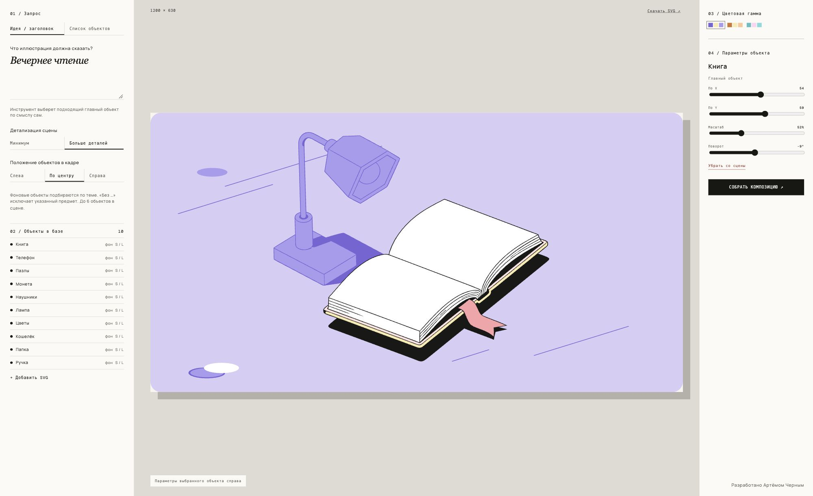
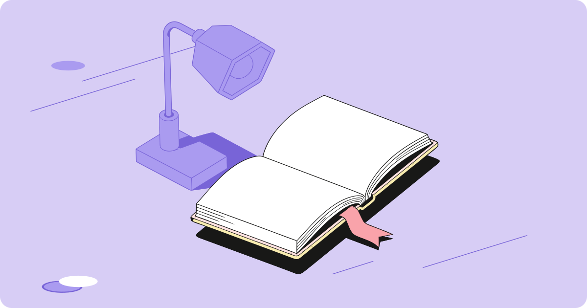
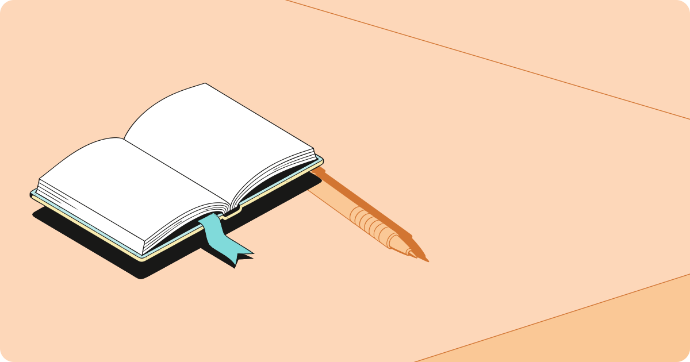
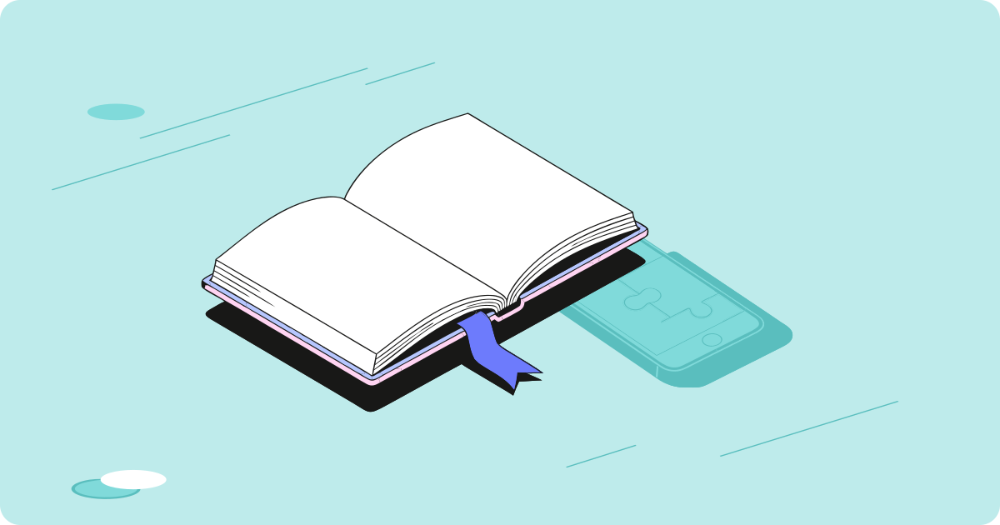
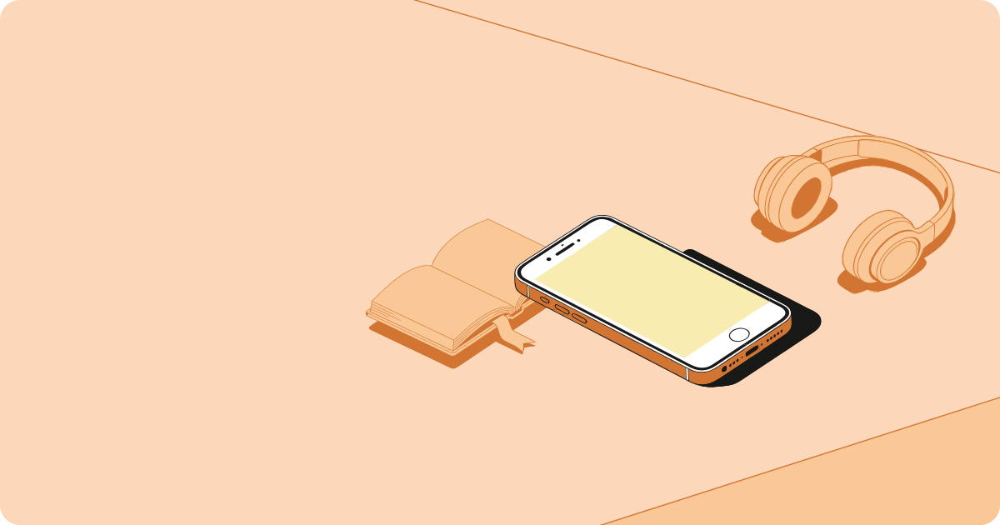
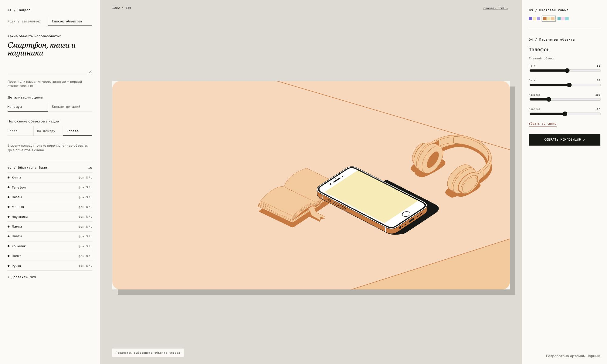

# Конструктор SVG-иллюстраций

Тестовое задание для команды компании «Очень».

Браузерный редактор собирает композицию из готовых SVG по теме или списку предметов. Главная часть проекта — локальный алгоритм подбора: он определяет, какие предметы выразят идею, и объясняет свой выбор. Готовую сцену можно отредактировать и скачать в SVG.

Исходные иллюстрации и палитры взяты из предоставленного комплекта Figma.



## Как работает подбор

Подбор и расстановка — два отдельных этапа. Первый отвечает за состав сцены, второй — за размеры и взаимное положение предметов. Весь алгоритм выполняется в браузере. Для подбора используются словарь понятий, веса связей и правила фоновых ролей, заданные в коде.

1. **Разбор запроса.** Текст нормализуется с учётом русских и английских форм слов, синонимов и некоторых опечаток. Алгоритм отделяет названия предметов от тематических понятий. Например, «смартфон» — явное упоминание телефона, а «дистанционное образование» — тема. Конструкции вроде «без наушников» запрещают выбирать предмет даже при высокой оценке по теме.
2. **Оценка кандидатов.** Для каждого предмета в каталоге заданы веса связи с понятиями. Сила совпадения — это вес понятия в запросе, умноженный на вес связи предмета с ним. Основу оценки составляет самое сильное совпадение. Остальные совпадения дают ограниченную прибавку. Тематический кандидат из встроенной библиотеки проходит порог, если его сильнейшее совпадение не ниже `0.6`. Связи с соседними понятиями слабее и сами по себе не преодолевают этот порог.
3. **Выбор состава.** Явно названные предметы идут первыми в порядке запроса. В режиме «Идея / заголовок» следом подбираются тематические кандидаты. При равных условиях предпочтение получает предмет, который раскрывает ещё не представленное понятие. Совместимость с уже выбранным предметом добавляет вес, а повтор категории снижает его. В режиме «Список объектов» тематическое дополнение отключено.
4. **Главный объект, фон и SVG-вариант.** Первый подходящий предмет получает главную роль. Контекстный фон добавляется по правилу с двумя условиями: в запросе распознана тема и в сцене уже есть подходящий опорный предмет. Затем выбирается конкретный цветной или монохромный SVG нужной детализации. Библиотека содержит 10 предметов и 40 вариантов. «Минимум» допускает до 4 предметов, «Больше деталей» — до 6. Если подходящих объектов нет, редактор показывает предупреждение.
5. **Расстановка.** Для известных пар можно задать относительные позиции, например, поставить лампу сверху слева от книги. Для остальных сочетаний применяются общие схемы. Один и тот же запрос с теми же настройками даёт тот же состав. Повторная сборка может изменить положение объектов.

### Разбор одного запроса

В запросе `Вечернее чтение` срабатывает понятие «Чтение». У книги связь с ним имеет вес `1.0`, поэтому она становится главным объектом. У лампы вес `0.35`, ниже порога тематического отбора. Она попадает в сцену по отдельному правилу: «Чтение» распознано, книга уже выбрана, лампа нужна как источник света рядом с разворотом. Правило расстановки задаёт относительные позиции этой пары.

Чтобы воспроизвести разбор, выполните после установки зависимостей:

```bash
pnpm selection:explain "Вечернее чтение"
```

Команда выводит выбранные SVG, оценки кандидатов, причины подбора и предупреждения. Словарь и правила рассчитаны на темы, покрытые небольшой библиотекой. Новые темы можно добавлять в [каталог понятий](src/lib/semantic/catalog.ts).

## Примеры иллюстраций

### «Вечернее чтение»

**Режим:** идея / заголовок · L · по центру. Цветная книга и монохромная лампа.



### «Подготовка к экзамену»

**Режим:** идея / заголовок · L · слева. Книга обозначает учебный материал, фоновая ручка — конспект.



### «Дистанционное образование без наушников»

**Режим:** идея / заголовок · L · по центру. Книга и телефон передают тему онлайн-обучения. Наушники исключены запросом.



### «Смартфон, книга и наушники»

**Режим:** список объектов · S · справа. Смартфон первый в списке и становится главным. Книга и наушники получают фоновые роли.



<details>
<summary>Скриншот редактора в режиме «Список объектов»</summary>



</details>

Группу можно расположить слева, по центру или справа в кадре 1200 × 630. В редакторе доступны три палитры и настройка позиции, масштаба и поворота каждого предмета. Свои SVG можно добавить на время сессии. Экспорт сохраняет векторные контуры, палитру и расположение объектов.

## Локальный запуск

Понадобятся Node.js 22+ и pnpm 11. Из корня проекта:

```bash
pnpm install --frozen-lockfile
pnpm dev
```

Откройте адрес, который Vite выведет в терминале.

## Стек и структура

React, TypeScript, Vite, Zustand и DOMPurify.

| Путь | Назначение |
| --- | --- |
| [`src/components/`](src/components/) | Панели запроса и сцены, холст |
| [`src/store.ts`](src/store.ts) | Состояние редактора |
| [`src/lib/semantic/`](src/lib/semantic/) | Разбор запроса, каталог понятий и выбор объектов |
| [`src/lib/composer.ts`](src/lib/composer.ts) и [`frame.ts`](src/lib/frame.ts) | Расстановка предметов и выравнивание группы |
| [`src/lib/relations.ts`](src/lib/relations.ts) | Пары предметов и варианты их взаимного положения |
| [`src/lib/render-scene.ts`](src/lib/render-scene.ts) | Общий SVG для предпросмотра и экспорта |
| [`src/lib/assets.ts`](src/lib/assets.ts) | Проверка и очистка импортируемых SVG |
| [`public/library/`](public/library/) | Манифест и встроенные иллюстрации |

## Проверки и публикация

```bash
pnpm test
pnpm build
pnpm preview
```

Тесты покрывают подбор, исключения из запроса, выбор вариантов S и L, размещение и формирование экспортного SVG.

Встроенные SVG и манифест входят в репозиторий. Дополнительные файлы для запуска не нужны.

Каталог `dist/` — готовая статическая сборка. Загрузите его содержимое на HTTPS-хостинг, в том числе GitHub Pages. Файл `index.html` и папки `assets/` и `library/` должны лежать рядом. Сборка поддерживает размещение в корне сайта и в подпапке. Для работы на хостинге достаточно статической раздачи файлов.

## Автор

Разработано Артёмом Черным.

Не для коммерческого использования.
